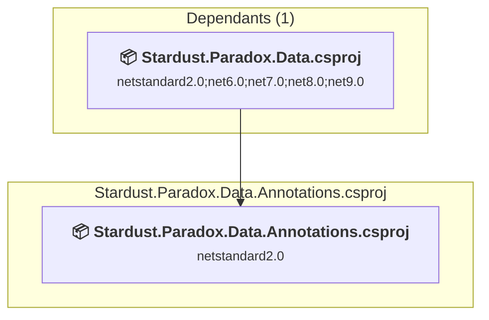
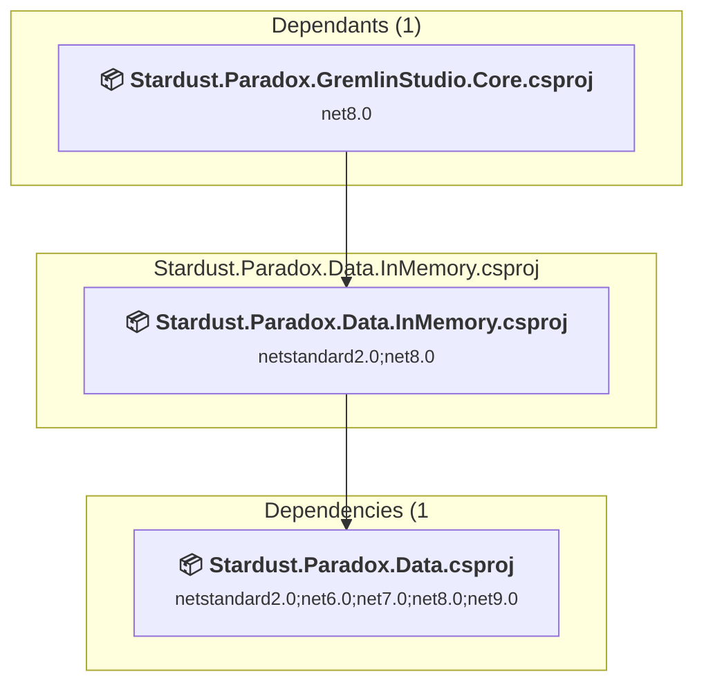
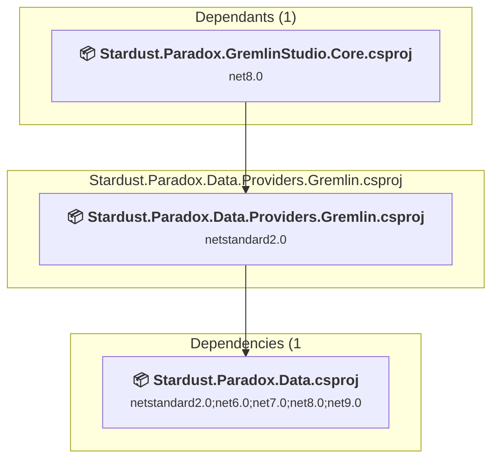
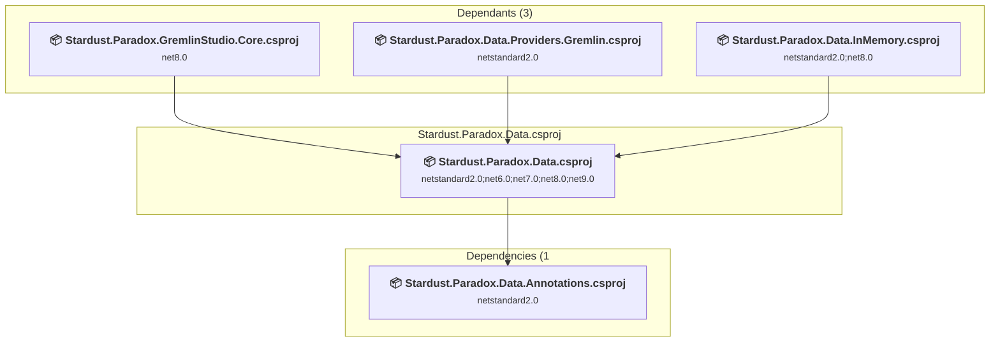
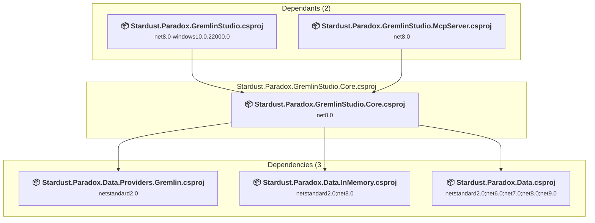
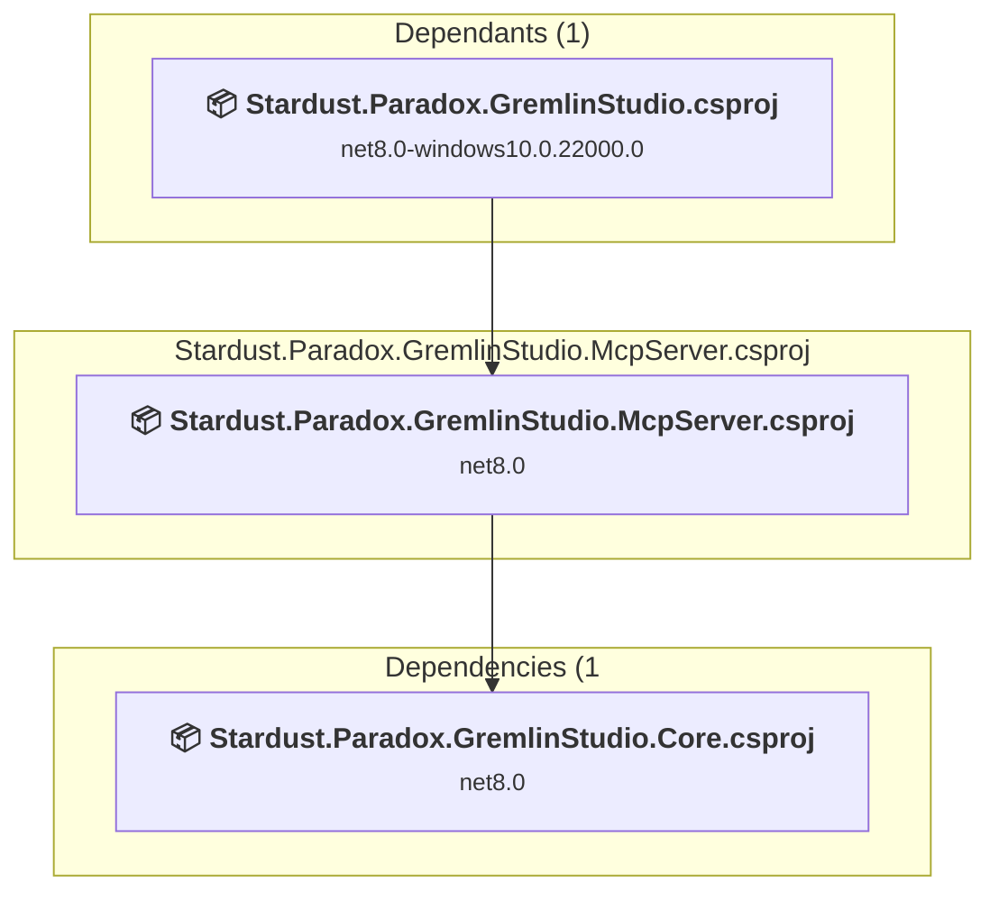
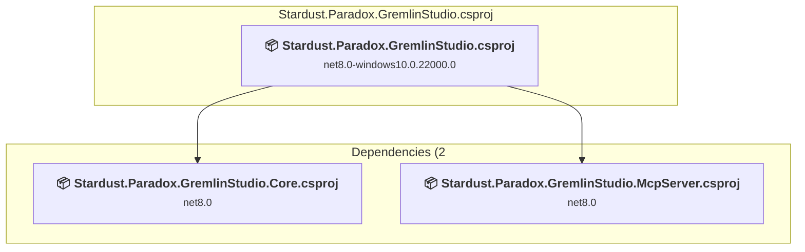

# Projects and dependencies analysis

This document provides a comprehensive overview of the projects and their dependencies in the context of upgrading to .NETCoreApp,Version=v10.0.

## Table of Contents

- [Executive Summary](#executive-Summary)
  - [Highlevel Metrics](#highlevel-metrics)
  - [Projects Compatibility](#projects-compatibility)
  - [Package Compatibility](#package-compatibility)
  - [API Compatibility](#api-compatibility)
  - [Binding Redirect Configuration](#binding-redirect-configuration)
- [Aggregate NuGet packages details](#aggregate-nuget-packages-details)
- [Top API Migration Challenges](#top-api-migration-challenges)
  - [Technologies and Features](#technologies-and-features)
  - [Most Frequent API Issues](#most-frequent-api-issues)
- [Projects Relationship Graph](#projects-relationship-graph)
- [Project Details](#project-details)

  - [C:\Private\Repos\JonasSyrstad\Stardust.Paradox\src\Stardust.Paradox.Data.Annotations\Stardust.Paradox.Data.Annotations.csproj](#c:privatereposjonassyrstadstardustparadoxsrcstardustparadoxdataannotationsstardustparadoxdataannotationscsproj)
  - [C:\Private\Repos\JonasSyrstad\Stardust.Paradox\src\Stardust.Paradox.Data.InMemory\Stardust.Paradox.Data.InMemory.csproj](#c:privatereposjonassyrstadstardustparadoxsrcstardustparadoxdatainmemorystardustparadoxdatainmemorycsproj)
  - [C:\Private\Repos\JonasSyrstad\Stardust.Paradox\src\Stardust.Paradox.Data.Providers.Gremlin\Stardust.Paradox.Data.Providers.Gremlin.csproj](#c:privatereposjonassyrstadstardustparadoxsrcstardustparadoxdataprovidersgremlinstardustparadoxdataprovidersgremlincsproj)
  - [C:\Private\Repos\JonasSyrstad\Stardust.Paradox\src\Stardust.Paradox.Data\Stardust.Paradox.Data.csproj](#c:privatereposjonassyrstadstardustparadoxsrcstardustparadoxdatastardustparadoxdatacsproj)
  - [Stardust.Paradox.GremlinStudio.Core\Stardust.Paradox.GremlinStudio.Core.csproj](#stardustparadoxgremlinstudiocorestardustparadoxgremlinstudiocorecsproj)
  - [Stardust.Paradox.GremlinStudio.McpServer\Stardust.Paradox.GremlinStudio.McpServer.csproj](#stardustparadoxgremlinstudiomcpserverstardustparadoxgremlinstudiomcpservercsproj)
  - [Stardust.Paradox.GremlinStudio\Stardust.Paradox.GremlinStudio.csproj](#stardustparadoxgremlinstudiostardustparadoxgremlinstudiocsproj)

## Executive Summary

### Highlevel Metrics

| Metric | Count | Status |
| :--- | :---: | :--- |
| Total Projects | 7 | All require upgrade |
| Total NuGet Packages | 46 | 3 need upgrade |
| Total Code Files | 378 |  |
| Total Code Files with Incidents | 72 |  |
| Total Lines of Code | 62604 |  |
| Total Number of Issues | 2899 |  |
| Estimated LOC to modify | 2857+ | at least 4,6% of codebase |

### Projects Compatibility

| Project | Target Framework | Difficulty | Package Issues | API Issues | Binding Issues | Est. LOC Impact | Description |
| :--- | :---: | :---: | :---: | :---: | :---: | :---: | :--- |
| [C:\Private\Repos\JonasSyrstad\Stardust.Paradox\src\Stardust.Paradox.Data.Annotations\Stardust.Paradox.Data.Annotations.csproj](#c:privatereposjonassyrstadstardustparadoxsrcstardustparadoxdataannotationsstardustparadoxdataannotationscsproj) | netstandard2.0 | 🟢 Low | 4 | 1 | 0 | 1+ | ClassLibrary, Sdk Style = True |
| [C:\Private\Repos\JonasSyrstad\Stardust.Paradox\src\Stardust.Paradox.Data.InMemory\Stardust.Paradox.Data.InMemory.csproj](#c:privatereposjonassyrstadstardustparadoxsrcstardustparadoxdatainmemorystardustparadoxdatainmemorycsproj) | netstandard2.0;net8.0 | 🟢 Low | 5 | 3 | 0 | 3+ | ClassLibrary, Sdk Style = True |
| [C:\Private\Repos\JonasSyrstad\Stardust.Paradox\src\Stardust.Paradox.Data.Providers.Gremlin\Stardust.Paradox.Data.Providers.Gremlin.csproj](#c:privatereposjonassyrstadstardustparadoxsrcstardustparadoxdataprovidersgremlinstardustparadoxdataprovidersgremlincsproj) | netstandard2.0 | 🟢 Low | 2 | 0 | 0 |  | ClassLibrary, Sdk Style = True |
| [C:\Private\Repos\JonasSyrstad\Stardust.Paradox\src\Stardust.Paradox.Data\Stardust.Paradox.Data.csproj](#c:privatereposjonassyrstadstardustparadoxsrcstardustparadoxdatastardustparadoxdatacsproj) | netstandard2.0;net6.0;net7.0;net8.0;net9.0 | 🟢 Low | 12 | 2 | 0 | 2+ | ClassLibrary, Sdk Style = True |
| [Stardust.Paradox.GremlinStudio.Core\Stardust.Paradox.GremlinStudio.Core.csproj](#stardustparadoxgremlinstudiocorestardustparadoxgremlinstudiocorecsproj) | net8.0 | 🟢 Low | 6 | 60 | 0 | 60+ | ClassLibrary, Sdk Style = True |
| [Stardust.Paradox.GremlinStudio.McpServer\Stardust.Paradox.GremlinStudio.McpServer.csproj](#stardustparadoxgremlinstudiomcpserverstardustparadoxgremlinstudiomcpservercsproj) | net8.0 | 🟢 Low | 3 | 0 | 0 |  | DotNetCoreApp, Sdk Style = True |
| [Stardust.Paradox.GremlinStudio\Stardust.Paradox.GremlinStudio.csproj](#stardustparadoxgremlinstudiostardustparadoxgremlinstudiocsproj) | net8.0-windows10.0.22000.0 | 🟡 Medium | 5 | 2791 | 0 | 2791+ | Wpf, Sdk Style = True |

### Package Compatibility

| Status | Count | Percentage |
| :--- | :---: | :---: |
| ✅ Compatible | 43 | 93,5% |
| ⚠️ Incompatible | 1 | 2,2% |
| 🔄 Upgrade Recommended | 2 | 4,3% |
| ***Total NuGet Packages*** | ***46*** | ***100%*** |

### API Compatibility

| Category | Count | Impact |
| :--- | :---: | :--- |
| 🔴 Binary Incompatible | 2740 | High - Require code changes |
| 🟡 Source Incompatible | 29 | Medium - Needs re-compilation and potential conflicting API error fixing |
| 🔵 Behavioral change | 88 | Low - Behavioral changes that may require testing at runtime |
| ✅ Compatible | 70516 |  |
| ***Total APIs Analyzed*** | ***73373*** |  |

## Aggregate NuGet packages details

| Package | Current Version | Suggested Version | Projects | Description |
| :--- | :---: | :---: | :--- | :--- |
| Gremlin.Net | 3.4.10 |  | [Stardust.Paradox.Data.InMemory.csproj](#c:privatereposjonassyrstadstardustparadoxsrcstardustparadoxdatainmemorystardustparadoxdatainmemorycsproj) [Stardust.Paradox.Data.Providers.Gremlin.csproj](#c:privatereposjonassyrstadstardustparadoxsrcstardustparadoxdataprovidersgremlinstardustparadoxdataprovidersgremlincsproj) | ✅Compatible |
| Microsoft.Build.Tasks.Git | 1.1.1 |  | [Stardust.Paradox.Data.InMemory.csproj](#c:privatereposjonassyrstadstardustparadoxsrcstardustparadoxdatainmemorystardustparadoxdatainmemorycsproj) | ✅Compatible |
| Microsoft.CSharp | 4.7.0 |  | [Stardust.Paradox.Data.csproj](#c:privatereposjonassyrstadstardustparadoxsrcstardustparadoxdatastardustparadoxdatacsproj) [Stardust.Paradox.Data.InMemory.csproj](#c:privatereposjonassyrstadstardustparadoxsrcstardustparadoxdatainmemorystardustparadoxdatainmemorycsproj) [Stardust.Paradox.Data.Providers.Gremlin.csproj](#c:privatereposjonassyrstadstardustparadoxsrcstardustparadoxdataprovidersgremlinstardustparadoxdataprovidersgremlincsproj) | ✅Compatible |
| Microsoft.Extensions.DependencyInjection.Abstractions | 2.1.1 | 10.0.13 | [Stardust.Paradox.Data.Annotations.csproj](#c:privatereposjonassyrstadstardustparadoxsrcstardustparadoxdataannotationsstardustparadoxdataannotationscsproj) [Stardust.Paradox.Data.csproj](#c:privatereposjonassyrstadstardustparadoxsrcstardustparadoxdatastardustparadoxdatacsproj) [Stardust.Paradox.Data.InMemory.csproj](#c:privatereposjonassyrstadstardustparadoxsrcstardustparadoxdatainmemorystardustparadoxdatainmemorycsproj) [Stardust.Paradox.Data.Providers.Gremlin.csproj](#c:privatereposjonassyrstadstardustparadoxsrcstardustparadoxdataprovidersgremlinstardustparadoxdataprovidersgremlincsproj) | NuGet package upgrade is recommended |
| Microsoft.NETCore.Platforms | 1.1.0 |  | [Stardust.Paradox.Data.Annotations.csproj](#c:privatereposjonassyrstadstardustparadoxsrcstardustparadoxdataannotationsstardustparadoxdataannotationscsproj) | ✅Compatible |
| Microsoft.NETCore.Platforms | 2.0.1 |  | [Stardust.Paradox.Data.csproj](#c:privatereposjonassyrstadstardustparadoxsrcstardustparadoxdatastardustparadoxdatacsproj) [Stardust.Paradox.Data.InMemory.csproj](#c:privatereposjonassyrstadstardustparadoxsrcstardustparadoxdatainmemorystardustparadoxdatainmemorycsproj) [Stardust.Paradox.Data.Providers.Gremlin.csproj](#c:privatereposjonassyrstadstardustparadoxsrcstardustparadoxdataprovidersgremlinstardustparadoxdataprovidersgremlincsproj) | ✅Compatible |
| Microsoft.NETCore.Targets | 1.1.0 |  | [Stardust.Paradox.Data.csproj](#c:privatereposjonassyrstadstardustparadoxsrcstardustparadoxdatastardustparadoxdatacsproj) [Stardust.Paradox.Data.Providers.Gremlin.csproj](#c:privatereposjonassyrstadstardustparadoxsrcstardustparadoxdataprovidersgremlinstardustparadoxdataprovidersgremlincsproj) | ✅Compatible |
| Microsoft.NETCore.Targets | 1.1.3 |  | [Stardust.Paradox.Data.InMemory.csproj](#c:privatereposjonassyrstadstardustparadoxsrcstardustparadoxdatainmemorystardustparadoxdatainmemorycsproj) | ✅Compatible |
| Microsoft.SourceLink.Common | 1.1.1 |  | [Stardust.Paradox.Data.InMemory.csproj](#c:privatereposjonassyrstadstardustparadoxsrcstardustparadoxdatainmemorystardustparadoxdatainmemorycsproj) | ✅Compatible |
| Microsoft.SourceLink.GitHub | 1.1.1 |  | [Stardust.Paradox.Data.InMemory.csproj](#c:privatereposjonassyrstadstardustparadoxsrcstardustparadoxdatainmemorystardustparadoxdatainmemorycsproj) | ✅Compatible |
| NETStandard.Library | 2.0.3 |  | [Stardust.Paradox.Data.Annotations.csproj](#c:privatereposjonassyrstadstardustparadoxsrcstardustparadoxdataannotationsstardustparadoxdataannotationscsproj) [Stardust.Paradox.Data.csproj](#c:privatereposjonassyrstadstardustparadoxsrcstardustparadoxdatastardustparadoxdatacsproj) [Stardust.Paradox.Data.InMemory.csproj](#c:privatereposjonassyrstadstardustparadoxsrcstardustparadoxdatainmemorystardustparadoxdatainmemorycsproj) [Stardust.Paradox.Data.Providers.Gremlin.csproj](#c:privatereposjonassyrstadstardustparadoxsrcstardustparadoxdataprovidersgremlinstardustparadoxdataprovidersgremlincsproj) | NuGet package functionality is included with framework reference |
| Newtonsoft.Json | 13.0.1 | 13.0.4 | [Stardust.Paradox.Data.Annotations.csproj](#c:privatereposjonassyrstadstardustparadoxsrcstardustparadoxdataannotationsstardustparadoxdataannotationscsproj) [Stardust.Paradox.Data.csproj](#c:privatereposjonassyrstadstardustparadoxsrcstardustparadoxdatastardustparadoxdatacsproj) [Stardust.Paradox.Data.InMemory.csproj](#c:privatereposjonassyrstadstardustparadoxsrcstardustparadoxdatainmemorystardustparadoxdatainmemorycsproj) [Stardust.Paradox.Data.Providers.Gremlin.csproj](#c:privatereposjonassyrstadstardustparadoxsrcstardustparadoxdataprovidersgremlinstardustparadoxdataprovidersgremlincsproj) | NuGet package upgrade is recommended |
| Polly | 7.2.0 |  | [Stardust.Paradox.Data.InMemory.csproj](#c:privatereposjonassyrstadstardustparadoxsrcstardustparadoxdatainmemorystardustparadoxdatainmemorycsproj) [Stardust.Paradox.Data.Providers.Gremlin.csproj](#c:privatereposjonassyrstadstardustparadoxsrcstardustparadoxdataprovidersgremlinstardustparadoxdataprovidersgremlincsproj) | ✅Compatible |
| runtime.native.System | 4.3.0 |  | [Stardust.Paradox.Data.csproj](#c:privatereposjonassyrstadstardustparadoxsrcstardustparadoxdatastardustparadoxdatacsproj) [Stardust.Paradox.Data.InMemory.csproj](#c:privatereposjonassyrstadstardustparadoxsrcstardustparadoxdatainmemorystardustparadoxdatainmemorycsproj) [Stardust.Paradox.Data.Providers.Gremlin.csproj](#c:privatereposjonassyrstadstardustparadoxsrcstardustparadoxdataprovidersgremlinstardustparadoxdataprovidersgremlincsproj) | ✅Compatible |
| runtime.native.System.IO.Compression | 4.3.0 |  | [Stardust.Paradox.Data.csproj](#c:privatereposjonassyrstadstardustparadoxsrcstardustparadoxdatastardustparadoxdatacsproj) [Stardust.Paradox.Data.InMemory.csproj](#c:privatereposjonassyrstadstardustparadoxsrcstardustparadoxdatainmemorystardustparadoxdatainmemorycsproj) [Stardust.Paradox.Data.Providers.Gremlin.csproj](#c:privatereposjonassyrstadstardustparadoxsrcstardustparadoxdataprovidersgremlinstardustparadoxdataprovidersgremlincsproj) | ✅Compatible |
| SecurityCodeScan | 3.4.0 |  | [Stardust.Paradox.Data.csproj](#c:privatereposjonassyrstadstardustparadoxsrcstardustparadoxdatastardustparadoxdatacsproj) | ⚠️NuGet package is deprecated |
| Stardust.Particles | 5.0.2 |  | [Stardust.Paradox.Data.csproj](#c:privatereposjonassyrstadstardustparadoxsrcstardustparadoxdatastardustparadoxdatacsproj) [Stardust.Paradox.Data.InMemory.csproj](#c:privatereposjonassyrstadstardustparadoxsrcstardustparadoxdatainmemorystardustparadoxdatainmemorycsproj) [Stardust.Paradox.Data.Providers.Gremlin.csproj](#c:privatereposjonassyrstadstardustparadoxsrcstardustparadoxdataprovidersgremlinstardustparadoxdataprovidersgremlincsproj) | ✅Compatible |
| System.Buffers | 4.3.0 |  | [Stardust.Paradox.Data.csproj](#c:privatereposjonassyrstadstardustparadoxsrcstardustparadoxdatastardustparadoxdatacsproj) [Stardust.Paradox.Data.InMemory.csproj](#c:privatereposjonassyrstadstardustparadoxsrcstardustparadoxdatainmemorystardustparadoxdatainmemorycsproj) [Stardust.Paradox.Data.Providers.Gremlin.csproj](#c:privatereposjonassyrstadstardustparadoxsrcstardustparadoxdataprovidersgremlinstardustparadoxdataprovidersgremlincsproj) | ✅Compatible |
| System.Collections | 4.3.0 |  | [Stardust.Paradox.Data.csproj](#c:privatereposjonassyrstadstardustparadoxsrcstardustparadoxdatastardustparadoxdatacsproj) [Stardust.Paradox.Data.InMemory.csproj](#c:privatereposjonassyrstadstardustparadoxsrcstardustparadoxdatainmemorystardustparadoxdatainmemorycsproj) [Stardust.Paradox.Data.Providers.Gremlin.csproj](#c:privatereposjonassyrstadstardustparadoxsrcstardustparadoxdataprovidersgremlinstardustparadoxdataprovidersgremlincsproj) | ✅Compatible |
| System.ComponentModel.Annotations | 4.7.0 |  | [Stardust.Paradox.Data.InMemory.csproj](#c:privatereposjonassyrstadstardustparadoxsrcstardustparadoxdatainmemorystardustparadoxdatainmemorycsproj) | NuGet package functionality is included with framework reference |
| System.Diagnostics.Debug | 4.3.0 |  | [Stardust.Paradox.Data.csproj](#c:privatereposjonassyrstadstardustparadoxsrcstardustparadoxdatastardustparadoxdatacsproj) [Stardust.Paradox.Data.InMemory.csproj](#c:privatereposjonassyrstadstardustparadoxsrcstardustparadoxdatainmemorystardustparadoxdatainmemorycsproj) [Stardust.Paradox.Data.Providers.Gremlin.csproj](#c:privatereposjonassyrstadstardustparadoxsrcstardustparadoxdataprovidersgremlinstardustparadoxdataprovidersgremlincsproj) | ✅Compatible |
| System.Diagnostics.Tracing | 4.3.0 |  | [Stardust.Paradox.Data.csproj](#c:privatereposjonassyrstadstardustparadoxsrcstardustparadoxdatastardustparadoxdatacsproj) [Stardust.Paradox.Data.InMemory.csproj](#c:privatereposjonassyrstadstardustparadoxsrcstardustparadoxdatainmemorystardustparadoxdatainmemorycsproj) [Stardust.Paradox.Data.Providers.Gremlin.csproj](#c:privatereposjonassyrstadstardustparadoxsrcstardustparadoxdataprovidersgremlinstardustparadoxdataprovidersgremlincsproj) | ✅Compatible |
| System.Globalization | 4.3.0 |  | [Stardust.Paradox.Data.csproj](#c:privatereposjonassyrstadstardustparadoxsrcstardustparadoxdatastardustparadoxdatacsproj) [Stardust.Paradox.Data.InMemory.csproj](#c:privatereposjonassyrstadstardustparadoxsrcstardustparadoxdatainmemorystardustparadoxdatainmemorycsproj) [Stardust.Paradox.Data.Providers.Gremlin.csproj](#c:privatereposjonassyrstadstardustparadoxsrcstardustparadoxdataprovidersgremlinstardustparadoxdataprovidersgremlincsproj) | ✅Compatible |
| System.IO | 4.3.0 |  | [Stardust.Paradox.Data.csproj](#c:privatereposjonassyrstadstardustparadoxsrcstardustparadoxdatastardustparadoxdatacsproj) [Stardust.Paradox.Data.InMemory.csproj](#c:privatereposjonassyrstadstardustparadoxsrcstardustparadoxdatainmemorystardustparadoxdatainmemorycsproj) [Stardust.Paradox.Data.Providers.Gremlin.csproj](#c:privatereposjonassyrstadstardustparadoxsrcstardustparadoxdataprovidersgremlinstardustparadoxdataprovidersgremlincsproj) | ✅Compatible |
| System.IO.Compression | 4.3.0 |  | [Stardust.Paradox.Data.csproj](#c:privatereposjonassyrstadstardustparadoxsrcstardustparadoxdatastardustparadoxdatacsproj) [Stardust.Paradox.Data.InMemory.csproj](#c:privatereposjonassyrstadstardustparadoxsrcstardustparadoxdatainmemorystardustparadoxdatainmemorycsproj) [Stardust.Paradox.Data.Providers.Gremlin.csproj](#c:privatereposjonassyrstadstardustparadoxsrcstardustparadoxdataprovidersgremlinstardustparadoxdataprovidersgremlincsproj) | NuGet package functionality is included with framework reference |
| System.Linq | 4.3.0 |  | [Stardust.Paradox.Data.csproj](#c:privatereposjonassyrstadstardustparadoxsrcstardustparadoxdatastardustparadoxdatacsproj) [Stardust.Paradox.Data.InMemory.csproj](#c:privatereposjonassyrstadstardustparadoxsrcstardustparadoxdatainmemorystardustparadoxdatainmemorycsproj) [Stardust.Paradox.Data.Providers.Gremlin.csproj](#c:privatereposjonassyrstadstardustparadoxsrcstardustparadoxdataprovidersgremlinstardustparadoxdataprovidersgremlincsproj) | ✅Compatible |
| System.Linq.Expressions | 4.3.0 |  | [Stardust.Paradox.Data.csproj](#c:privatereposjonassyrstadstardustparadoxsrcstardustparadoxdatastardustparadoxdatacsproj) [Stardust.Paradox.Data.InMemory.csproj](#c:privatereposjonassyrstadstardustparadoxsrcstardustparadoxdatainmemorystardustparadoxdatainmemorycsproj) [Stardust.Paradox.Data.Providers.Gremlin.csproj](#c:privatereposjonassyrstadstardustparadoxsrcstardustparadoxdataprovidersgremlinstardustparadoxdataprovidersgremlincsproj) | ✅Compatible |
| System.ObjectModel | 4.3.0 |  | [Stardust.Paradox.Data.csproj](#c:privatereposjonassyrstadstardustparadoxsrcstardustparadoxdatastardustparadoxdatacsproj) [Stardust.Paradox.Data.InMemory.csproj](#c:privatereposjonassyrstadstardustparadoxsrcstardustparadoxdatainmemorystardustparadoxdatainmemorycsproj) [Stardust.Paradox.Data.Providers.Gremlin.csproj](#c:privatereposjonassyrstadstardustparadoxsrcstardustparadoxdataprovidersgremlinstardustparadoxdataprovidersgremlincsproj) | ✅Compatible |
| System.Reflection | 4.3.0 |  | [Stardust.Paradox.Data.csproj](#c:privatereposjonassyrstadstardustparadoxsrcstardustparadoxdatastardustparadoxdatacsproj) [Stardust.Paradox.Data.InMemory.csproj](#c:privatereposjonassyrstadstardustparadoxsrcstardustparadoxdatainmemorystardustparadoxdatainmemorycsproj) [Stardust.Paradox.Data.Providers.Gremlin.csproj](#c:privatereposjonassyrstadstardustparadoxsrcstardustparadoxdataprovidersgremlinstardustparadoxdataprovidersgremlincsproj) | NuGet package functionality is included with framework reference |
| System.Reflection.Emit | 4.7.0 |  | [Stardust.Paradox.Data.csproj](#c:privatereposjonassyrstadstardustparadoxsrcstardustparadoxdatastardustparadoxdatacsproj) [Stardust.Paradox.Data.InMemory.csproj](#c:privatereposjonassyrstadstardustparadoxsrcstardustparadoxdatainmemorystardustparadoxdatainmemorycsproj) [Stardust.Paradox.Data.Providers.Gremlin.csproj](#c:privatereposjonassyrstadstardustparadoxsrcstardustparadoxdataprovidersgremlinstardustparadoxdataprovidersgremlincsproj) | NuGet package functionality is included with framework reference |
| System.Reflection.Emit.ILGeneration | 4.7.0 |  | [Stardust.Paradox.Data.csproj](#c:privatereposjonassyrstadstardustparadoxsrcstardustparadoxdatastardustparadoxdatacsproj) [Stardust.Paradox.Data.InMemory.csproj](#c:privatereposjonassyrstadstardustparadoxsrcstardustparadoxdatainmemorystardustparadoxdatainmemorycsproj) [Stardust.Paradox.Data.Providers.Gremlin.csproj](#c:privatereposjonassyrstadstardustparadoxsrcstardustparadoxdataprovidersgremlinstardustparadoxdataprovidersgremlincsproj) | NuGet package functionality is included with framework reference |
| System.Reflection.Emit.Lightweight | 4.7.0 |  | [Stardust.Paradox.Data.csproj](#c:privatereposjonassyrstadstardustparadoxsrcstardustparadoxdatastardustparadoxdatacsproj) [Stardust.Paradox.Data.InMemory.csproj](#c:privatereposjonassyrstadstardustparadoxsrcstardustparadoxdatainmemorystardustparadoxdatainmemorycsproj) [Stardust.Paradox.Data.Providers.Gremlin.csproj](#c:privatereposjonassyrstadstardustparadoxsrcstardustparadoxdataprovidersgremlinstardustparadoxdataprovidersgremlincsproj) | NuGet package functionality is included with framework reference |
| System.Reflection.Extensions | 4.3.0 |  | [Stardust.Paradox.Data.csproj](#c:privatereposjonassyrstadstardustparadoxsrcstardustparadoxdatastardustparadoxdatacsproj) [Stardust.Paradox.Data.InMemory.csproj](#c:privatereposjonassyrstadstardustparadoxsrcstardustparadoxdatainmemorystardustparadoxdatainmemorycsproj) [Stardust.Paradox.Data.Providers.Gremlin.csproj](#c:privatereposjonassyrstadstardustparadoxsrcstardustparadoxdataprovidersgremlinstardustparadoxdataprovidersgremlincsproj) | ✅Compatible |
| System.Reflection.Primitives | 4.3.0 |  | [Stardust.Paradox.Data.csproj](#c:privatereposjonassyrstadstardustparadoxsrcstardustparadoxdatastardustparadoxdatacsproj) [Stardust.Paradox.Data.InMemory.csproj](#c:privatereposjonassyrstadstardustparadoxsrcstardustparadoxdatainmemorystardustparadoxdatainmemorycsproj) [Stardust.Paradox.Data.Providers.Gremlin.csproj](#c:privatereposjonassyrstadstardustparadoxsrcstardustparadoxdataprovidersgremlinstardustparadoxdataprovidersgremlincsproj) | NuGet package functionality is included with framework reference |
| System.Reflection.TypeExtensions | 4.7.0 |  | [Stardust.Paradox.Data.csproj](#c:privatereposjonassyrstadstardustparadoxsrcstardustparadoxdatastardustparadoxdatacsproj) [Stardust.Paradox.Data.InMemory.csproj](#c:privatereposjonassyrstadstardustparadoxsrcstardustparadoxdatainmemorystardustparadoxdatainmemorycsproj) [Stardust.Paradox.Data.Providers.Gremlin.csproj](#c:privatereposjonassyrstadstardustparadoxsrcstardustparadoxdataprovidersgremlinstardustparadoxdataprovidersgremlincsproj) | NuGet package functionality is included with framework reference |
| System.Resources.ResourceManager | 4.3.0 |  | [Stardust.Paradox.Data.csproj](#c:privatereposjonassyrstadstardustparadoxsrcstardustparadoxdatastardustparadoxdatacsproj) [Stardust.Paradox.Data.InMemory.csproj](#c:privatereposjonassyrstadstardustparadoxsrcstardustparadoxdatainmemorystardustparadoxdatainmemorycsproj) [Stardust.Paradox.Data.Providers.Gremlin.csproj](#c:privatereposjonassyrstadstardustparadoxsrcstardustparadoxdataprovidersgremlinstardustparadoxdataprovidersgremlincsproj) | ✅Compatible |
| System.Runtime | 4.3.0 |  | [Stardust.Paradox.Data.csproj](#c:privatereposjonassyrstadstardustparadoxsrcstardustparadoxdatastardustparadoxdatacsproj) [Stardust.Paradox.Data.Providers.Gremlin.csproj](#c:privatereposjonassyrstadstardustparadoxsrcstardustparadoxdataprovidersgremlinstardustparadoxdataprovidersgremlincsproj) | ✅Compatible |
| System.Runtime | 4.3.1 |  | [Stardust.Paradox.Data.InMemory.csproj](#c:privatereposjonassyrstadstardustparadoxsrcstardustparadoxdatainmemorystardustparadoxdatainmemorycsproj) | ✅Compatible |
| System.Runtime.Extensions | 4.3.0 |  | [Stardust.Paradox.Data.csproj](#c:privatereposjonassyrstadstardustparadoxsrcstardustparadoxdatastardustparadoxdatacsproj) [Stardust.Paradox.Data.Providers.Gremlin.csproj](#c:privatereposjonassyrstadstardustparadoxsrcstardustparadoxdataprovidersgremlinstardustparadoxdataprovidersgremlincsproj) | ✅Compatible |
| System.Runtime.Extensions | 4.3.1 |  | [Stardust.Paradox.Data.InMemory.csproj](#c:privatereposjonassyrstadstardustparadoxsrcstardustparadoxdatainmemorystardustparadoxdatainmemorycsproj) | ✅Compatible |
| System.Runtime.Handles | 4.3.0 |  | [Stardust.Paradox.Data.csproj](#c:privatereposjonassyrstadstardustparadoxsrcstardustparadoxdatastardustparadoxdatacsproj) [Stardust.Paradox.Data.InMemory.csproj](#c:privatereposjonassyrstadstardustparadoxsrcstardustparadoxdatainmemorystardustparadoxdatainmemorycsproj) [Stardust.Paradox.Data.Providers.Gremlin.csproj](#c:privatereposjonassyrstadstardustparadoxsrcstardustparadoxdataprovidersgremlinstardustparadoxdataprovidersgremlincsproj) | ✅Compatible |
| System.Runtime.InteropServices | 4.3.0 |  | [Stardust.Paradox.Data.csproj](#c:privatereposjonassyrstadstardustparadoxsrcstardustparadoxdatastardustparadoxdatacsproj) [Stardust.Paradox.Data.InMemory.csproj](#c:privatereposjonassyrstadstardustparadoxsrcstardustparadoxdatainmemorystardustparadoxdatainmemorycsproj) [Stardust.Paradox.Data.Providers.Gremlin.csproj](#c:privatereposjonassyrstadstardustparadoxsrcstardustparadoxdataprovidersgremlinstardustparadoxdataprovidersgremlincsproj) | ✅Compatible |
| System.Text.Encoding | 4.3.0 |  | [Stardust.Paradox.Data.csproj](#c:privatereposjonassyrstadstardustparadoxsrcstardustparadoxdatastardustparadoxdatacsproj) [Stardust.Paradox.Data.InMemory.csproj](#c:privatereposjonassyrstadstardustparadoxsrcstardustparadoxdatainmemorystardustparadoxdatainmemorycsproj) [Stardust.Paradox.Data.Providers.Gremlin.csproj](#c:privatereposjonassyrstadstardustparadoxsrcstardustparadoxdataprovidersgremlinstardustparadoxdataprovidersgremlincsproj) | ✅Compatible |
| System.Text.RegularExpressions | 4.3.1 |  | [Stardust.Paradox.Data.InMemory.csproj](#c:privatereposjonassyrstadstardustparadoxsrcstardustparadoxdatainmemorystardustparadoxdatainmemorycsproj) | NuGet package functionality is included with framework reference |
| System.Threading | 4.3.0 |  | [Stardust.Paradox.Data.csproj](#c:privatereposjonassyrstadstardustparadoxsrcstardustparadoxdatastardustparadoxdatacsproj) [Stardust.Paradox.Data.InMemory.csproj](#c:privatereposjonassyrstadstardustparadoxsrcstardustparadoxdatainmemorystardustparadoxdatainmemorycsproj) [Stardust.Paradox.Data.Providers.Gremlin.csproj](#c:privatereposjonassyrstadstardustparadoxsrcstardustparadoxdataprovidersgremlinstardustparadoxdataprovidersgremlincsproj) | ✅Compatible |
| System.Threading.Tasks | 4.3.0 |  | [Stardust.Paradox.Data.csproj](#c:privatereposjonassyrstadstardustparadoxsrcstardustparadoxdatastardustparadoxdatacsproj) [Stardust.Paradox.Data.InMemory.csproj](#c:privatereposjonassyrstadstardustparadoxsrcstardustparadoxdatainmemorystardustparadoxdatainmemorycsproj) [Stardust.Paradox.Data.Providers.Gremlin.csproj](#c:privatereposjonassyrstadstardustparadoxsrcstardustparadoxdataprovidersgremlinstardustparadoxdataprovidersgremlincsproj) | ✅Compatible |

## Top API Migration Challenges

### Technologies and Features

| Technology | Issues | Percentage | Migration Path |
| :--- | :---: | :---: | :--- |
| WPF (Windows Presentation Foundation) | 1525 | 53,4% | WPF APIs for building Windows desktop applications with XAML-based UI that are available in .NET on Windows. WPF provides rich desktop UI capabilities with data binding and styling. Enable Windows Desktop support: Option 1 (Recommended): Target net9.0-windows; Option 2: Add <UseWindowsDesktop>true</UseWindowsDesktop>. |

### Most Frequent API Issues

| API | Count | Percentage | Category |
| :--- | :---: | :---: | :--- |
| T:System.Windows.Media.Brush | 131 | 4,6% | Binary Incompatible |
| T:System.Windows.RoutedEventHandler | 82 | 2,9% | Binary Incompatible |
| T:System.Windows.Controls.TextBlock | 63 | 2,2% | Binary Incompatible |
| T:System.Windows.Visibility | 55 | 1,9% | Binary Incompatible |
| T:System.Windows.Thickness | 50 | 1,8% | Binary Incompatible |
| T:System.Windows.Application | 47 | 1,6% | Binary Incompatible |
| T:System.Windows.Point | 40 | 1,4% | Binary Incompatible |
| T:System.Windows.DependencyProperty | 37 | 1,3% | Binary Incompatible |
| T:System.Windows.Input.Key | 36 | 1,3% | Binary Incompatible |
| P:System.Windows.Controls.TextBlock.Text | 34 | 1,2% | Binary Incompatible |
| T:System.Windows.Controls.TextBox | 33 | 1,2% | Binary Incompatible |
| T:System.Windows.DependencyObject | 33 | 1,2% | Binary Incompatible |
| T:System.Windows.Media.SolidColorBrush | 32 | 1,1% | Binary Incompatible |
| T:System.Windows.RoutedEventArgs | 31 | 1,1% | Binary Incompatible |
| T:System.Windows.Controls.UIElementCollection | 30 | 1,1% | Binary Incompatible |
| P:System.Windows.Controls.Panel.Children | 30 | 1,1% | Binary Incompatible |
| M:System.Windows.Controls.UIElementCollection.Add(System.Windows.UIElement) | 30 | 1,1% | Binary Incompatible |
| T:System.Windows.Window | 29 | 1,0% | Binary Incompatible |
| T:System.Windows.Controls.Border | 29 | 1,0% | Binary Incompatible |
| T:System.Windows.Media.FontFamily | 28 | 1,0% | Binary Incompatible |
| P:System.Windows.FrameworkElement.DataContext | 27 | 0,9% | Binary Incompatible |
| T:System.Uri | 26 | 0,9% | Behavioral Change |
| T:System.Windows.Controls.Button | 26 | 0,9% | Binary Incompatible |
| M:System.Windows.Controls.TextBlock.#ctor | 25 | 0,9% | Binary Incompatible |
| T:System.Windows.Input.ModifierKeys | 24 | 0,8% | Binary Incompatible |
| T:System.Windows.UIElement | 24 | 0,8% | Binary Incompatible |
| T:System.Text.Json.JsonDocument | 23 | 0,8% | Behavioral Change |
| P:System.Windows.Controls.TextBlock.FontSize | 23 | 0,8% | Binary Incompatible |
| E:System.Windows.Controls.Primitives.ButtonBase.Click | 22 | 0,8% | Binary Incompatible |
| T:System.Windows.Input.KeyEventHandler | 22 | 0,8% | Binary Incompatible |
| P:System.Windows.RoutedEventArgs.Handled | 22 | 0,8% | Binary Incompatible |
| P:Microsoft.Win32.FileDialog.FileName | 22 | 0,8% | Binary Incompatible |
| T:System.Windows.Input.MouseEventHandler | 22 | 0,8% | Binary Incompatible |
| M:System.Windows.Thickness.#ctor(System.Double,System.Double,System.Double,System.Double) | 22 | 0,8% | Binary Incompatible |
| T:System.Windows.VerticalAlignment | 21 | 0,7% | Binary Incompatible |
| T:System.Windows.Input.MouseButtonEventHandler | 20 | 0,7% | Binary Incompatible |
| P:System.Windows.Controls.TextBlock.Foreground | 20 | 0,7% | Binary Incompatible |
| T:System.Windows.WindowState | 20 | 0,7% | Binary Incompatible |
| P:System.Windows.FrameworkElement.Margin | 19 | 0,7% | Binary Incompatible |
| P:System.Windows.Application.Current | 18 | 0,6% | Binary Incompatible |
| T:System.Windows.Media.Color | 18 | 0,6% | Binary Incompatible |
| T:System.Windows.Controls.Primitives.Popup | 18 | 0,6% | Binary Incompatible |
| M:System.Windows.Point.#ctor(System.Double,System.Double) | 17 | 0,6% | Binary Incompatible |
| M:System.Windows.Window.Close | 16 | 0,6% | Binary Incompatible |
| T:System.Windows.FontWeight | 16 | 0,6% | Binary Incompatible |
| P:System.Windows.Controls.TextBox.Text | 15 | 0,5% | Binary Incompatible |
| T:System.Windows.Data.IValueConverter | 15 | 0,5% | Binary Incompatible |
| P:System.Windows.Window.DialogResult | 14 | 0,5% | Binary Incompatible |
| M:System.Windows.Window.#ctor | 14 | 0,5% | Binary Incompatible |
| T:System.Windows.Media.Brushes | 14 | 0,5% | Binary Incompatible |

## Projects Relationship Graph

Legend:
📦 SDK-style project
⚙️ Classic project

```mermaid
flowchart LR
    P1["<b>📦&nbsp;Stardust.Paradox.GremlinStudio.csproj</b><br/><small>net8.0-windows10.0.22000.0</small>"]
    P2["<b>📦&nbsp;Stardust.Paradox.GremlinStudio.McpServer.csproj</b><br/><small>net8.0</small>"]
    P3["<b>📦&nbsp;Stardust.Paradox.GremlinStudio.Core.csproj</b><br/><small>net8.0</small>"]
    P4["<b>📦&nbsp;Stardust.Paradox.Data.Providers.Gremlin.csproj</b><br/><small>netstandard2.0</small>"]
    P5["<b>📦&nbsp;Stardust.Paradox.Data.InMemory.csproj</b><br/><small>netstandard2.0;net8.0</small>"]
    P6["<b>📦&nbsp;Stardust.Paradox.Data.csproj</b><br/><small>netstandard2.0;net6.0;net7.0;net8.0;net9.0</small>"]
    P7["<b>📦&nbsp;Stardust.Paradox.Data.Annotations.csproj</b><br/><small>netstandard2.0</small>"]
    P1 --> P3
    P1 --> P2
    P2 --> P3
    P3 --> P4
    P3 --> P5
    P3 --> P6
    P4 --> P6
    P5 --> P6
    P6 --> P7
    click P1 "#stardustparadoxgremlinstudiostardustparadoxgremlinstudiocsproj"
    click P2 "#stardustparadoxgremlinstudiomcpserverstardustparadoxgremlinstudiomcpservercsproj"
    click P3 "#stardustparadoxgremlinstudiocorestardustparadoxgremlinstudiocorecsproj"
    click P4 "#c:privatereposjonassyrstadstardustparadoxsrcstardustparadoxdataprovidersgremlinstardustparadoxdataprovidersgremlincsproj"
    click P5 "#c:privatereposjonassyrstadstardustparadoxsrcstardustparadoxdatainmemorystardustparadoxdatainmemorycsproj"
    click P6 "#c:privatereposjonassyrstadstardustparadoxsrcstardustparadoxdatastardustparadoxdatacsproj"
    click P7 "#c:privatereposjonassyrstadstardustparadoxsrcstardustparadoxdataannotationsstardustparadoxdataannotationscsproj"

```

## Project Details

### C:\Private\Repos\JonasSyrstad\Stardust.Paradox\src\Stardust.Paradox.Data.Annotations\Stardust.Paradox.Data.Annotations.csproj

#### Project Info

- **Current Target Framework:** netstandard2.0✅
- **SDK-style**: True
- **Project Kind:** ClassLibrary
- **Dependencies**: 0
- **Dependants**: 1
- **Number of Files**: 28
- **Number of Files with Incidents**: 3
- **Lines of Code**: 1863
- **Estimated LOC to modify**: 1+ (at least 0,1% of the project)

#### Dependency Graph

Legend:
📦 SDK-style project
⚙️ Classic project

### API Compatibility

| Category | Count | Impact |
| :--- | :---: | :--- |
| 🔴 Binary Incompatible | 0 | High - Require code changes |
| 🟡 Source Incompatible | 1 | Medium - Needs re-compilation and potential conflicting API error fixing |
| 🔵 Behavioral change | 0 | Low - Behavioral changes that may require testing at runtime |
| ✅ Compatible | 1442 |  |
| ***Total APIs Analyzed*** | ***1443*** |  |

#### Project Package References

| Package | Type | Current Version | Suggested Version | Description |
| :--- | :---: | :---: | :---: | :--- |
| Microsoft.Extensions.DependencyInjection.Abstractions | Explicit | 2.1.1 | 10.0.13 | NuGet package upgrade is recommended |
| Microsoft.NETCore.Platforms | 🔗*Transitive* | 1.1.0 |  | ✅Compatible |
| NETStandard.Library | Explicit | 2.0.3 |  | NuGet package functionality is included with framework reference |
| Newtonsoft.Json | Explicit | 13.0.1 | 13.0.4 | NuGet package upgrade is recommended |

### C:\Private\Repos\JonasSyrstad\Stardust.Paradox\src\Stardust.Paradox.Data.InMemory\Stardust.Paradox.Data.InMemory.csproj

#### Project Info

- **Current Target Framework:** netstandard2.0;net8.0
- **Proposed Target Framework:** netstandard2.0;net8.0;net10.0
- **SDK-style**: True
- **Project Kind:** ClassLibrary
- **Dependencies**: 1
- **Dependants**: 1
- **Number of Files**: 165
- **Number of Files with Incidents**: 4
- **Lines of Code**: 30376
- **Estimated LOC to modify**: 3+ (at least 0,0% of the project)

#### Dependency Graph

Legend:
📦 SDK-style project
⚙️ Classic project

### API Compatibility

| Category | Count | Impact |
| :--- | :---: | :--- |
| 🔴 Binary Incompatible | 0 | High - Require code changes |
| 🟡 Source Incompatible | 1 | Medium - Needs re-compilation and potential conflicting API error fixing |
| 🔵 Behavioral change | 2 | Low - Behavioral changes that may require testing at runtime |
| ✅ Compatible | 23558 |  |
| ***Total APIs Analyzed*** | ***23561*** |  |

#### Project Package References

| Package | Type | Current Version | Suggested Version | Description |
| :--- | :---: | :---: | :---: | :--- |
| Gremlin.Net | Explicit | 3.4.10 |  | ✅Compatible |
| Microsoft.Build.Tasks.Git | 🔗*Transitive* | 1.1.1 |  | ✅Compatible |
| Microsoft.CSharp | 🔗*Transitive* | 4.7.0 |  | ✅Compatible |
| Microsoft.Extensions.DependencyInjection.Abstractions | 🔗*Transitive* | 2.1.1 | 10.0.13 | NuGet package upgrade is recommended |
| Microsoft.NETCore.Platforms | 🔗*Transitive* | 2.0.1 |  | ✅Compatible |
| Microsoft.NETCore.Targets | 🔗*Transitive* | 1.1.3 |  | ✅Compatible |
| Microsoft.SourceLink.Common | 🔗*Transitive* | 1.1.1 |  | ✅Compatible |
| Microsoft.SourceLink.GitHub | Explicit | 1.1.1 |  | ✅Compatible |
| NETStandard.Library | Explicit | 2.0.3 |  | NuGet package functionality is included with framework reference |
| Newtonsoft.Json | Explicit | 13.0.1 | 13.0.4 | NuGet package upgrade is recommended |
| Polly | 🔗*Transitive* | 7.2.0 |  | ✅Compatible |
| runtime.native.System | 🔗*Transitive* | 4.3.0 |  | ✅Compatible |
| runtime.native.System.IO.Compression | 🔗*Transitive* | 4.3.0 |  | ✅Compatible |
| Stardust.Particles | 🔗*Transitive* | 5.0.2 |  | ✅Compatible |
| System.Buffers | 🔗*Transitive* | 4.3.0 |  | ✅Compatible |
| System.Collections | 🔗*Transitive* | 4.3.0 |  | ✅Compatible |
| System.ComponentModel.Annotations | Explicit | 4.7.0 |  | NuGet package functionality is included with framework reference |
| System.Diagnostics.Debug | 🔗*Transitive* | 4.3.0 |  | ✅Compatible |
| System.Diagnostics.Tracing | 🔗*Transitive* | 4.3.0 |  | ✅Compatible |
| System.Globalization | 🔗*Transitive* | 4.3.0 |  | ✅Compatible |
| System.IO | 🔗*Transitive* | 4.3.0 |  | ✅Compatible |
| System.IO.Compression | 🔗*Transitive* | 4.3.0 |  | NuGet package functionality is included with framework reference |
| System.Linq | 🔗*Transitive* | 4.3.0 |  | ✅Compatible |
| System.Linq.Expressions | 🔗*Transitive* | 4.3.0 |  | ✅Compatible |
| System.ObjectModel | 🔗*Transitive* | 4.3.0 |  | ✅Compatible |
| System.Reflection | 🔗*Transitive* | 4.3.0 |  | NuGet package functionality is included with framework reference |
| System.Reflection.Emit | 🔗*Transitive* | 4.7.0 |  | NuGet package functionality is included with framework reference |
| System.Reflection.Emit.ILGeneration | 🔗*Transitive* | 4.7.0 |  | NuGet package functionality is included with framework reference |
| System.Reflection.Emit.Lightweight | 🔗*Transitive* | 4.7.0 |  | NuGet package functionality is included with framework reference |
| System.Reflection.Extensions | 🔗*Transitive* | 4.3.0 |  | ✅Compatible |
| System.Reflection.Primitives | 🔗*Transitive* | 4.3.0 |  | NuGet package functionality is included with framework reference |
| System.Reflection.TypeExtensions | 🔗*Transitive* | 4.7.0 |  | NuGet package functionality is included with framework reference |
| System.Resources.ResourceManager | 🔗*Transitive* | 4.3.0 |  | ✅Compatible |
| System.Runtime | 🔗*Transitive* | 4.3.1 |  | ✅Compatible |
| System.Runtime.Extensions | 🔗*Transitive* | 4.3.1 |  | ✅Compatible |
| System.Runtime.Handles | 🔗*Transitive* | 4.3.0 |  | ✅Compatible |
| System.Runtime.InteropServices | 🔗*Transitive* | 4.3.0 |  | ✅Compatible |
| System.Text.Encoding | 🔗*Transitive* | 4.3.0 |  | ✅Compatible |
| System.Text.RegularExpressions | Explicit | 4.3.1 |  | NuGet package functionality is included with framework reference |
| System.Threading | 🔗*Transitive* | 4.3.0 |  | ✅Compatible |
| System.Threading.Tasks | 🔗*Transitive* | 4.3.0 |  | ✅Compatible |

### C:\Private\Repos\JonasSyrstad\Stardust.Paradox\src\Stardust.Paradox.Data.Providers.Gremlin\Stardust.Paradox.Data.Providers.Gremlin.csproj

#### Project Info

- **Current Target Framework:** netstandard2.0✅
- **SDK-style**: True
- **Project Kind:** ClassLibrary
- **Dependencies**: 1
- **Dependants**: 1
- **Number of Files**: 3
- **Number of Files with Incidents**: 2
- **Lines of Code**: 314
- **Estimated LOC to modify**: 0+ (at least 0,0% of the project)

#### Dependency Graph

Legend:
📦 SDK-style project
⚙️ Classic project

### API Compatibility

| Category | Count | Impact |
| :--- | :---: | :--- |
| 🔴 Binary Incompatible | 0 | High - Require code changes |
| 🟡 Source Incompatible | 0 | Medium - Needs re-compilation and potential conflicting API error fixing |
| 🔵 Behavioral change | 0 | Low - Behavioral changes that may require testing at runtime |
| ✅ Compatible | 267 |  |
| ***Total APIs Analyzed*** | ***267*** |  |

#### Project Package References

| Package | Type | Current Version | Suggested Version | Description |
| :--- | :---: | :---: | :---: | :--- |
| Gremlin.Net | Explicit | 3.4.10 |  | ✅Compatible |
| Microsoft.CSharp | 🔗*Transitive* | 4.7.0 |  | ✅Compatible |
| Microsoft.Extensions.DependencyInjection.Abstractions | 🔗*Transitive* | 2.1.1 | 10.0.13 | NuGet package upgrade is recommended |
| Microsoft.NETCore.Platforms | 🔗*Transitive* | 2.0.1 |  | ✅Compatible |
| Microsoft.NETCore.Targets | 🔗*Transitive* | 1.1.0 |  | ✅Compatible |
| NETStandard.Library | Explicit | 2.0.3 |  | NuGet package functionality is included with framework reference |
| Newtonsoft.Json | 🔗*Transitive* | 13.0.1 | 13.0.4 | NuGet package upgrade is recommended |
| Polly | 🔗*Transitive* | 7.2.0 |  | ✅Compatible |
| runtime.native.System | 🔗*Transitive* | 4.3.0 |  | ✅Compatible |
| runtime.native.System.IO.Compression | 🔗*Transitive* | 4.3.0 |  | ✅Compatible |
| Stardust.Particles | 🔗*Transitive* | 5.0.2 |  | ✅Compatible |
| System.Buffers | 🔗*Transitive* | 4.3.0 |  | ✅Compatible |
| System.Collections | 🔗*Transitive* | 4.3.0 |  | ✅Compatible |
| System.Diagnostics.Debug | 🔗*Transitive* | 4.3.0 |  | ✅Compatible |
| System.Diagnostics.Tracing | 🔗*Transitive* | 4.3.0 |  | ✅Compatible |
| System.Globalization | 🔗*Transitive* | 4.3.0 |  | ✅Compatible |
| System.IO | 🔗*Transitive* | 4.3.0 |  | ✅Compatible |
| System.IO.Compression | 🔗*Transitive* | 4.3.0 |  | NuGet package functionality is included with framework reference |
| System.Linq | 🔗*Transitive* | 4.3.0 |  | ✅Compatible |
| System.Linq.Expressions | 🔗*Transitive* | 4.3.0 |  | ✅Compatible |
| System.ObjectModel | 🔗*Transitive* | 4.3.0 |  | ✅Compatible |
| System.Reflection | 🔗*Transitive* | 4.3.0 |  | NuGet package functionality is included with framework reference |
| System.Reflection.Emit | 🔗*Transitive* | 4.7.0 |  | NuGet package functionality is included with framework reference |
| System.Reflection.Emit.ILGeneration | 🔗*Transitive* | 4.7.0 |  | NuGet package functionality is included with framework reference |
| System.Reflection.Emit.Lightweight | 🔗*Transitive* | 4.7.0 |  | NuGet package functionality is included with framework reference |
| System.Reflection.Extensions | 🔗*Transitive* | 4.3.0 |  | ✅Compatible |
| System.Reflection.Primitives | 🔗*Transitive* | 4.3.0 |  | NuGet package functionality is included with framework reference |
| System.Reflection.TypeExtensions | 🔗*Transitive* | 4.7.0 |  | NuGet package functionality is included with framework reference |
| System.Resources.ResourceManager | 🔗*Transitive* | 4.3.0 |  | ✅Compatible |
| System.Runtime | 🔗*Transitive* | 4.3.0 |  | ✅Compatible |
| System.Runtime.Extensions | 🔗*Transitive* | 4.3.0 |  | ✅Compatible |
| System.Runtime.Handles | 🔗*Transitive* | 4.3.0 |  | ✅Compatible |
| System.Runtime.InteropServices | 🔗*Transitive* | 4.3.0 |  | ✅Compatible |
| System.Text.Encoding | 🔗*Transitive* | 4.3.0 |  | ✅Compatible |
| System.Threading | 🔗*Transitive* | 4.3.0 |  | ✅Compatible |
| System.Threading.Tasks | 🔗*Transitive* | 4.3.0 |  | ✅Compatible |

### C:\Private\Repos\JonasSyrstad\Stardust.Paradox\src\Stardust.Paradox.Data\Stardust.Paradox.Data.csproj

#### Project Info

- **Current Target Framework:** netstandard2.0;net6.0;net7.0;net8.0;net9.0
- **Proposed Target Framework:** netstandard2.0;net6.0;net7.0;net8.0;net9.0;net10.0
- **SDK-style**: True
- **Project Kind:** ClassLibrary
- **Dependencies**: 1
- **Dependants**: 3
- **Number of Files**: 74
- **Number of Files with Incidents**: 3
- **Lines of Code**: 8280
- **Estimated LOC to modify**: 2+ (at least 0,0% of the project)

#### Dependency Graph

Legend:
📦 SDK-style project
⚙️ Classic project

### API Compatibility

| Category | Count | Impact |
| :--- | :---: | :--- |
| 🔴 Binary Incompatible | 0 | High - Require code changes |
| 🟡 Source Incompatible | 2 | Medium - Needs re-compilation and potential conflicting API error fixing |
| 🔵 Behavioral change | 0 | Low - Behavioral changes that may require testing at runtime |
| ✅ Compatible | 7814 |  |
| ***Total APIs Analyzed*** | ***7816*** |  |

#### Project Package References

| Package | Type | Current Version | Suggested Version | Description |
| :--- | :---: | :---: | :---: | :--- |
| Microsoft.CSharp | Explicit | 4.7.0 |  | ✅Compatible |
| Microsoft.Extensions.DependencyInjection.Abstractions | Explicit | 2.1.1 | 10.0.13 | NuGet package upgrade is recommended |
| Microsoft.NETCore.Platforms | 🔗*Transitive* | 2.0.1 |  | ✅Compatible |
| Microsoft.NETCore.Targets | 🔗*Transitive* | 1.1.0 |  | ✅Compatible |
| NETStandard.Library | Explicit | 2.0.3 |  | NuGet package functionality is included with framework reference |
| Newtonsoft.Json | Explicit | 13.0.1 | 13.0.4 | NuGet package upgrade is recommended |
| runtime.native.System | 🔗*Transitive* | 4.3.0 |  | ✅Compatible |
| runtime.native.System.IO.Compression | 🔗*Transitive* | 4.3.0 |  | ✅Compatible |
| SecurityCodeScan | Explicit | 3.4.0 |  | ⚠️NuGet package is deprecated |
| Stardust.Particles | Explicit | 5.0.2 |  | ✅Compatible |
| System.Buffers | 🔗*Transitive* | 4.3.0 |  | ✅Compatible |
| System.Collections | 🔗*Transitive* | 4.3.0 |  | ✅Compatible |
| System.Diagnostics.Debug | 🔗*Transitive* | 4.3.0 |  | ✅Compatible |
| System.Diagnostics.Tracing | 🔗*Transitive* | 4.3.0 |  | ✅Compatible |
| System.Globalization | 🔗*Transitive* | 4.3.0 |  | ✅Compatible |
| System.IO | 🔗*Transitive* | 4.3.0 |  | ✅Compatible |
| System.IO.Compression | Explicit | 4.3.0 |  | NuGet package functionality is included with framework reference |
| System.Linq | 🔗*Transitive* | 4.3.0 |  | ✅Compatible |
| System.Linq.Expressions | 🔗*Transitive* | 4.3.0 |  | ✅Compatible |
| System.ObjectModel | 🔗*Transitive* | 4.3.0 |  | ✅Compatible |
| System.Reflection | Explicit | 4.3.0 |  | NuGet package functionality is included with framework reference |
| System.Reflection.Emit | Explicit | 4.7.0 |  | NuGet package functionality is included with framework reference |
| System.Reflection.Emit.ILGeneration | Explicit | 4.7.0 |  | NuGet package functionality is included with framework reference |
| System.Reflection.Emit.Lightweight | Explicit | 4.7.0 |  | NuGet package functionality is included with framework reference |
| System.Reflection.Extensions | 🔗*Transitive* | 4.3.0 |  | ✅Compatible |
| System.Reflection.Primitives | Explicit | 4.3.0 |  | NuGet package functionality is included with framework reference |
| System.Reflection.TypeExtensions | Explicit | 4.7.0 |  | NuGet package functionality is included with framework reference |
| System.Resources.ResourceManager | 🔗*Transitive* | 4.3.0 |  | ✅Compatible |
| System.Runtime | 🔗*Transitive* | 4.3.0 |  | ✅Compatible |
| System.Runtime.Extensions | 🔗*Transitive* | 4.3.0 |  | ✅Compatible |
| System.Runtime.Handles | 🔗*Transitive* | 4.3.0 |  | ✅Compatible |
| System.Runtime.InteropServices | 🔗*Transitive* | 4.3.0 |  | ✅Compatible |
| System.Text.Encoding | 🔗*Transitive* | 4.3.0 |  | ✅Compatible |
| System.Threading | 🔗*Transitive* | 4.3.0 |  | ✅Compatible |
| System.Threading.Tasks | 🔗*Transitive* | 4.3.0 |  | ✅Compatible |

### Stardust.Paradox.GremlinStudio.Core\Stardust.Paradox.GremlinStudio.Core.csproj

#### Project Info

- **Current Target Framework:** net8.0
- **Proposed Target Framework:** net10.0
- **SDK-style**: True
- **Project Kind:** ClassLibrary
- **Dependencies**: 3
- **Dependants**: 2
- **Number of Files**: 57
- **Number of Files with Incidents**: 12
- **Lines of Code**: 5800
- **Estimated LOC to modify**: 60+ (at least 1,0% of the project)

#### Dependency Graph

Legend:
📦 SDK-style project
⚙️ Classic project

### API Compatibility

| Category | Count | Impact |
| :--- | :---: | :--- |
| 🔴 Binary Incompatible | 0 | High - Require code changes |
| 🟡 Source Incompatible | 11 | Medium - Needs re-compilation and potential conflicting API error fixing |
| 🔵 Behavioral change | 49 | Low - Behavioral changes that may require testing at runtime |
| ✅ Compatible | 6878 |  |
| ***Total APIs Analyzed*** | ***6938*** |  |

### Stardust.Paradox.GremlinStudio.McpServer\Stardust.Paradox.GremlinStudio.McpServer.csproj

#### Project Info

- **Current Target Framework:** net8.0
- **Proposed Target Framework:** net10.0
- **SDK-style**: True
- **Project Kind:** DotNetCoreApp
- **Dependencies**: 1
- **Dependants**: 1
- **Number of Files**: 6
- **Number of Files with Incidents**: 2
- **Lines of Code**: 775
- **Estimated LOC to modify**: 0+ (at least 0,0% of the project)

#### Dependency Graph

Legend:
📦 SDK-style project
⚙️ Classic project

### API Compatibility

| Category | Count | Impact |
| :--- | :---: | :--- |
| 🔴 Binary Incompatible | 0 | High - Require code changes |
| 🟡 Source Incompatible | 0 | Medium - Needs re-compilation and potential conflicting API error fixing |
| 🔵 Behavioral change | 0 | Low - Behavioral changes that may require testing at runtime |
| ✅ Compatible | 1352 |  |
| ***Total APIs Analyzed*** | ***1352*** |  |

### Stardust.Paradox.GremlinStudio\Stardust.Paradox.GremlinStudio.csproj

#### Project Info

- **Current Target Framework:** net8.0-windows10.0.22000.0
- **Proposed Target Framework:** net10.0-windows
- **SDK-style**: True
- **Project Kind:** Wpf
- **Dependencies**: 2
- **Dependants**: 0
- **Number of Files**: 45
- **Number of Files with Incidents**: 46
- **Lines of Code**: 15196
- **Estimated LOC to modify**: 2791+ (at least 18,4% of the project)

#### Dependency Graph

Legend:
📦 SDK-style project
⚙️ Classic project

### API Compatibility

| Category | Count | Impact |
| :--- | :---: | :--- |
| 🔴 Binary Incompatible | 2740 | High - Require code changes |
| 🟡 Source Incompatible | 14 | Medium - Needs re-compilation and potential conflicting API error fixing |
| 🔵 Behavioral change | 37 | Low - Behavioral changes that may require testing at runtime |
| ✅ Compatible | 29205 |  |
| ***Total APIs Analyzed*** | ***31996*** |  |

#### Project Technologies and Features

| Technology | Issues | Percentage | Migration Path |
| :--- | :---: | :---: | :--- |
| WPF (Windows Presentation Foundation) | 1525 | 54,6% | WPF APIs for building Windows desktop applications with XAML-based UI that are available in .NET on Windows. WPF provides rich desktop UI capabilities with data binding and styling. Enable Windows Desktop support: Option 1 (Recommended): Target net9.0-windows; Option 2: Add <UseWindowsDesktop>true</UseWindowsDesktop>. |

